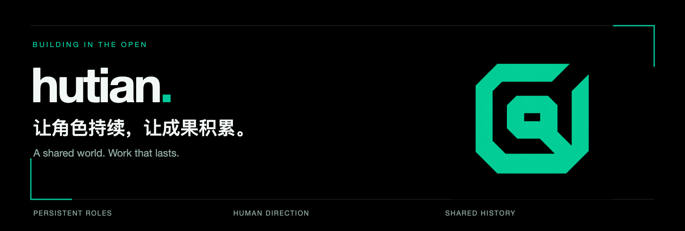

  

  <a href="https://github.com/hutian-ai/harness-dock"><strong>Harness Dock</strong></a> ·
  <a href="https://hutian-ai.github.io/harness-dock/">产品文档</a> ·
  <a href="https://hutian-ai.github.io/harness-dock/sdk/#quick-connect">SDK 快速开始</a> ·
  <a href="https://github.com/hutian-ai/harness-dock/releases">下载与版本</a>

## 一个让人和持续角色共同工作的世界

**hutian 正在探索：让 AI 角色拥有持续的身份、项目经历与记忆，由人协调，完成真实工作。**

角色可以参与不同项目，背后的执行 Agent、Harness 和设备可以在任务之间更换。我们希望把值得保留的资料、经验与成果留在同一个世界里，让下一次工作有据可循。

*A shared world for persistent AI roles, human-directed collaboration, and work that builds on what came before.*

### 从可独立使用的工具开始

<table>
<tr>
<td width="100%">

#### 界舟 · Harness Dock

**让原生 Harness，为你的产品执行任务。**

通过 TypeScript SDK 连接获授权的设备，复用已有的原生安装、登录和工具环境。应用选择设备、发起任务，接回进度、原生审批与产物；执行留在所选设备上。

`TypeScript SDK` · `自托管 Server` · `独立设备后台` · `macOS 客户端`

当前公开版本为 Developer Alpha，设备执行支持 macOS Apple Silicon；Codex 已支持，DeepSeek Harness（dsh）为实验适配。

[查看源码 →](https://github.com/hutian-ai/harness-dock)　[阅读文档 →](https://hutian-ai.github.io/harness-dock/)　[发起第一次任务 →](https://hutian-ai.github.io/harness-dock/sdk/#quick-connect)

</td>
</tr>
</table>

### 我们正在构建什么

| 方向 | 希望解决的问题 | 当前状态 |
| :--- | :--- | :--- |
| **执行 · Harness Dock** | 让应用调用所选设备上的原生 Harness | 已公开，持续迭代 |
| **协作 · hutian Web** | 管理持续角色、项目与人的协作 | 本地开发中，尚未公开 |
| **通信、记忆与知识** | 保留讨论、可引用资料和有来源的工作经验 | 独立能力验证与接入推进中，尚未公开 |

完整的角色协作与任务交付流程仍在建设中。当前可下载、可接入的公开成果，请从 Harness Dock 开始。

### 我们如何推进

- **人来协调。** 分配、转交、验收和扩大授权，由人决定。
- **每一步都能用。** 先交付能独立运行的小成果，再逐步连接成产品。
- **经验有出处。** 让工作摘要、资料和成果可引用、可核对、可修正。

欢迎从公开项目的 [Issues](https://github.com/hutian-ai/harness-dock/issues) 交流真实使用场景，或阅读 [贡献指南](https://github.com/hutian-ai/harness-dock/blob/main/CONTRIBUTING.md) 参与改进。

---

人创造角色，角色参与项目，成果成为共同历史。

