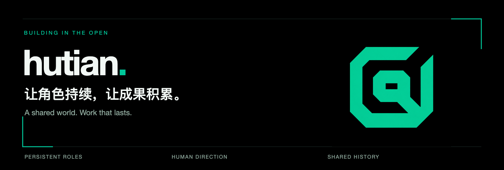

  

  <a href="https://github.com/hutian-ai/harness-dock"><strong>Harness Dock</strong></a> ·
  <a href="https://hutian-ai.github.io/harness-dock/">执行文档</a> ·
  <a href="https://github.com/hutian-ai/hutian-design"><strong>Hutian Design</strong></a> ·
  <a href="https://hutian-ai.github.io/hutian-design/">设计文档</a>

## 一个让人和持续角色共同工作的世界

**hutian 正在探索：让 AI 角色拥有持续的身份、项目经历与记忆，由人协调，完成真实工作。**

角色可以参与不同项目，背后的执行 Agent、Harness 和设备可以在任务之间更换。我们希望把值得保留的资料、经验与成果留在同一个世界里，让下一次工作有据可循。

*A shared world for persistent AI roles, human-directed collaboration, and work that builds on what came before.*

> **高频迭代中。** 当前各项目仍在持续开发与真实场景验证，接口、配置和交互可能调整。使用前请查看对应仓库的 README、版本说明与已知限制。

### 可独立使用的开源项目

<table>
<tr>
<td width="100%">

#### 界舟 · Harness Dock

**让原生 Harness，为你的产品执行任务。**

通过 TypeScript SDK 连接获授权的设备，复用已有的原生安装、登录和工具环境。应用选择设备、发起任务，接回进度、原生审批与产物；执行留在所选设备上。

`TypeScript SDK` · `自托管 Server` · `独立设备后台` · `macOS App` · `Windows 实验支持`

当前公开版本为 Developer Alpha，提供 macOS Apple Silicon 客户端与 Windows 11 x64 实验客户端。原生 Harness 适配、安装方式与平台限制见产品文档。

[查看源码 →](https://github.com/hutian-ai/harness-dock)　[阅读文档 →](https://hutian-ai.github.io/harness-dock/)　[SDK 快速开始 →](https://hutian-ai.github.io/harness-dock/sdk/#quick-connect)　[下载与版本 →](https://github.com/hutian-ai/harness-dock/releases)

</td>
</tr>
<tr>
<td width="100%">

#### Hutian Design

**为 Agent 协作应用统一视觉与聊天交互。**

独立的 React 设计系统，包含主题、40 个基础组件与 Chat UI。覆盖消息、输入、附件、思考摘要、工具过程、引用和审批呈现，通过数据与回调接入应用。

`React` · `Tailwind CSS 4` · `Radix UI` · `assistant-ui` · `MIT`

交互式文档支持组件预览、使用代码、属性说明与实际源码查看。组件库与文档站可独立运行，业务消息、权限和执行协议由消费应用提供。

[查看源码 →](https://github.com/hutian-ai/hutian-design)　[阅读文档 →](https://hutian-ai.github.io/hutian-design/)　[基础组件 →](https://hutian-ai.github.io/hutian-design/#/components/button)　[Chat UI →](https://hutian-ai.github.io/hutian-design/#/chat/thread)

</td>
</tr>
<tr>
<td width="100%">

#### Memory Gateway

**为应用与 Agent 提供统一、可授权的记忆接入。**

提供 REST、MCP 与 CLI，按资源授予读写权限，并保留可核对的来源与操作回执。支持 Hindsight、Mem0 OSS 和受管笔记；Mem0 Platform 适配仍待真实账号验证。

`Python` · `REST / MCP / CLI` · `资源范围授权` · `多后端适配` · `MIT`

[查看源码 →](https://github.com/hutian-ai/memory-gateway)　[协议说明 →](https://github.com/hutian-ai/memory-gateway/blob/main/PROTOCOL.md)

</td>
</tr>
<tr>
<td width="100%">

#### Matrix Agents Chat

**连接人与 Agent，让沟通与交接留在同一段历史里。**

基于 Matrix / Synapse 的独立通信工具，提供房间、成员、消息、引用回复、历史与断线补收。通过 TypeScript SDK、CLI 或本机网页接入，由人选择回复对象与交接；外部宿主负责模型和执行。

`TypeScript SDK` · `CLI / Web` · `Matrix / Synapse` · `人工交接` · `MIT`

[查看源码 →](https://github.com/hutian-ai/matrix-agents-chat)　[SDK 接入 →](https://github.com/hutian-ai/matrix-agents-chat/blob/main/docs/sdk.md)　[部署说明 →](https://github.com/hutian-ai/matrix-agents-chat/blob/main/docs/deployment.md)

</td>
</tr>
</table>

### 我们正在构建什么

| 方向 | 希望解决的问题 | 当前状态 |
| :--- | :--- | :--- |
| **执行 · Harness Dock** | 让应用调用所选设备上的原生 Harness | 已开源，Developer Alpha |
| **界面 · Hutian Design** | 为 Agent 应用复用基础组件与聊天交互 | 已开源，MIT；文档已上线 |
| **协作 · hutian Web** | 管理持续角色、沟通与人的协作 | MVP 迭代中，源码尚未公开 |
| **记忆 · Memory Gateway** | 通过统一授权接口读写记忆、保留来源与操作回执 | 已开源，高频迭代中 |
| **通信 · Matrix Agents Chat** | 连接人与 Agent 的消息、群聊与人工交接 | 已开源，高频迭代中 |
| **知识** | 管理可引用的资料 | 独立能力验证与接入推进中，尚未公开 |

完整的角色协作与任务交付流程仍在建设中。原生执行从 Harness Dock 开始，应用界面与 Chat UI 从 Hutian Design 开始；通信接入可查看 Matrix Agents Chat，记忆接入可查看 Memory Gateway。

### 我们如何推进

- **人来协调。** 分配、转交、验收和扩大授权，由人决定。
- **每一步都能用。** 先交付能独立运行的小成果，再逐步连接成产品。
- **经验有出处。** 让工作摘要、资料和成果可引用、可核对、可修正。

欢迎在 [Harness Dock Issues](https://github.com/hutian-ai/harness-dock/issues) 或 [Hutian Design Issues](https://github.com/hutian-ai/hutian-design/issues) 交流真实使用场景；参与开发请阅读各项目的贡献指南。

---

人创造角色，角色参与项目，成果成为共同历史。

